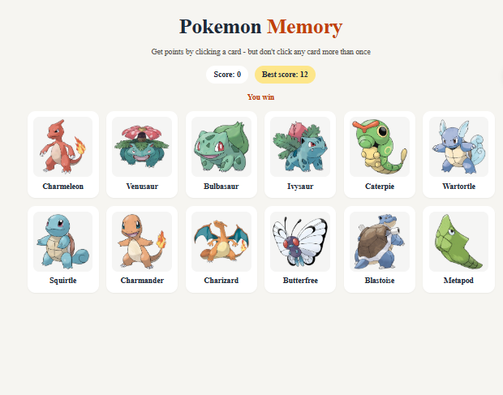

# Memory Card

A memory game built with React. Click each card only once: the cards shuffle after every click, and clicking the same card twice ends your run. See how many you can remember in a row.

**Live demo:** [add your link once deployed]



## How to play

- Click any card to score a point.
- After each click, the cards shuffle into a new order.
- Click a card you've already chosen and your score resets to 0.
- Your best score is kept so you can try to beat it.

## Features

- Current score and best score
- Cards shuffle on every click and when the game first loads
- Card images and names fetched from [add the API you use, e.g. PokéAPI or Giphy]
- Responsive layout for phones, tablets and desktops

## Built with

- [React](https://react.dev/) (`useState`, `useEffect`)
- [Vite](https://vite.dev/)
- CSS

## Running it locally

```
git clone https://github.com/whyitboi/memory-card.git
cd memory-card
npm install
npm run dev
```

Then open the address Vite prints, usually `http://localhost:5173`.

| Command           | What it does                                  |
| ----------------- | --------------------------------------------- |
| `npm run dev`     | Starts the development server                 |
| `npm run build`   | Creates the production build in `dist/`       |
| `npm run preview` | Serves the production build locally to test it |

## About this project

This is [The Odin Project's Memory Card project](https://www.theodinproject.com/lessons/node-path-react-new-memory-card) from the React course.
